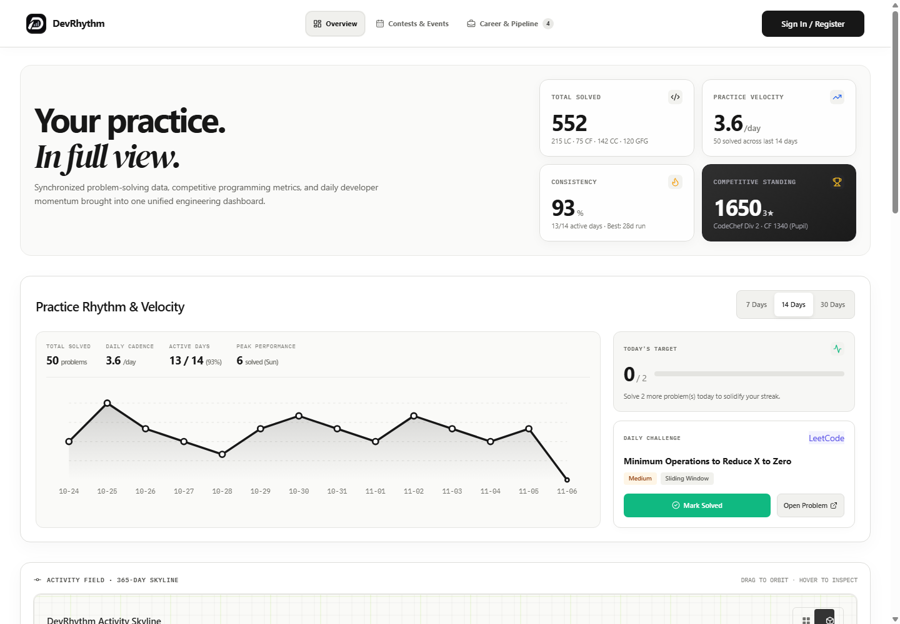
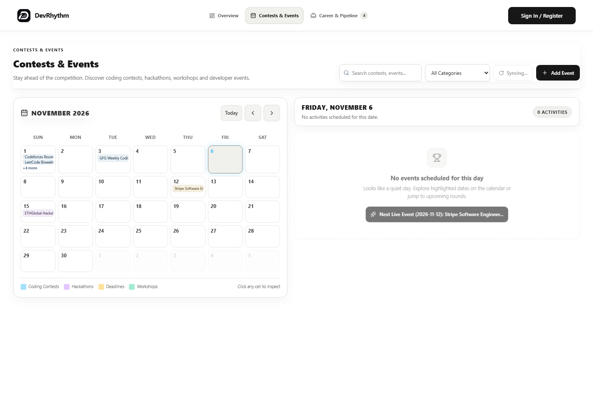
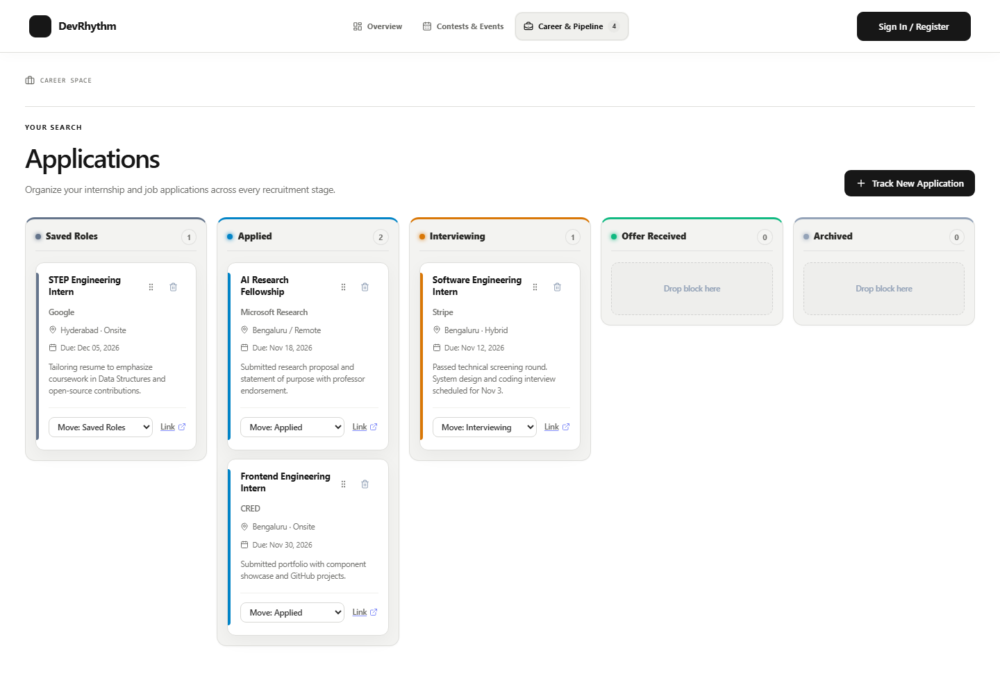
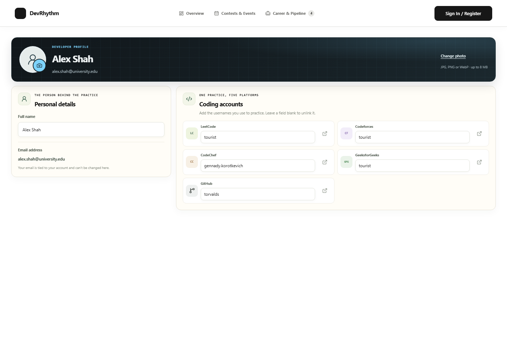
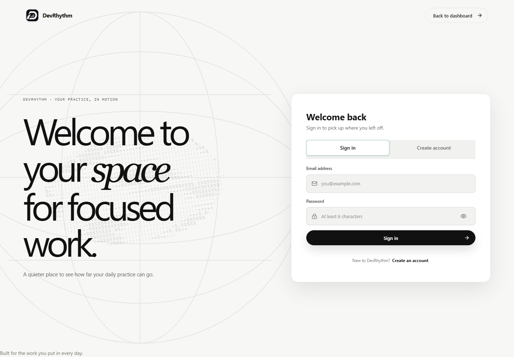
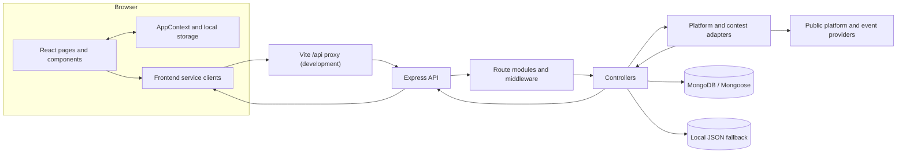
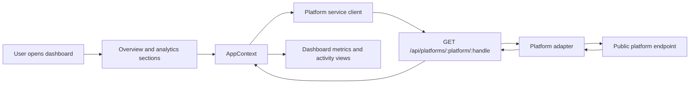
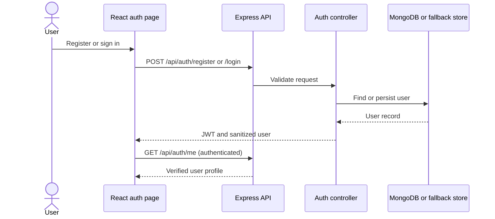
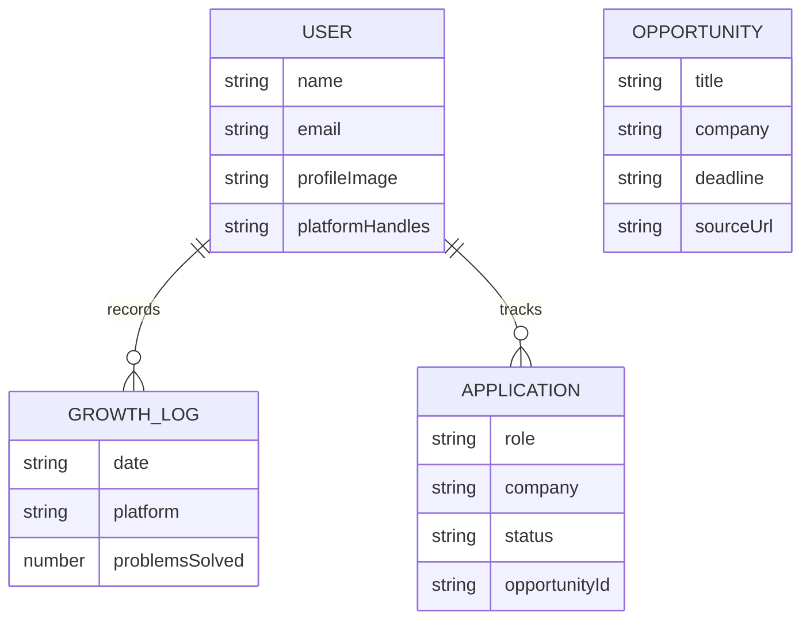

# DevRhythm

**Your coding practice, in full view.**

DevRhythm brings coding activity, practice streaks, contest schedules, and application tracking into one developer dashboard. Connect public profiles from coding platforms, inspect practice trends, and keep your career pipeline alongside your progress.



## What you can do

- **See your practice at a glance.** Review solved-problem totals, daily cadence, active days, recent activity, and streak health.
- **Bring platform profiles together.** Look up public profiles on LeetCode, Codeforces, CodeChef, GeeksforGeeks, and GitHub.
- **Explore your activity.** Inspect platform metrics, practice trends, and streak health in the dashboard.
- **Keep up with events.** Browse coding contests, hackathons, workshops, and deadlines in the calendar.
- **Organize your career search.** Track applications through their stages and maintain a profile with your skills and platform handles.
- **Log practice.** Record activity against a supported platform and follow your consistency over time.

> **Data note:** Platform and contest information depends on each provider's public endpoints and availability. The interface also includes sample data so that the product can be explored without connecting every service. Treat retrieved metrics as provider data, not as a guarantee of identical coverage across platforms.

## Screenshots

| Overview |
|---|
|  |

| Contests and events | Career pipeline |
|---|---|
|  |  |

| Profile | Sign in |
|---|---|
|  |  |

## Architecture

The client is a React single-page application. In development, Vite proxies `/api` requests to Express. The API routes requests through controllers to MongoDB-backed models or the local JSON fallback store; platform adapters fetch public profile and event data from their providers.



### Main workflows

**Platform sync and analytics**



**Authentication**



**Data model**



`Application.opportunityId` is stored as a string; it is not a MongoDB reference to `Opportunity`. See the editable [architecture](docs/diagrams/architecture.md), [workflow](docs/diagrams/workflow.md), [data-flow](docs/diagrams/data-flow.md), [module-interaction](docs/diagrams/module-interaction.md), [authentication](docs/diagrams/authentication.md), and [database ER](docs/diagrams/database-er.md) diagrams.

## Tech stack

| Layer | Technologies |
|---|---|
| Frontend | React 18, Vite, JavaScript/JSX, CSS |
| Backend | Node.js, Express |
| Persistence | MongoDB with Mongoose; local JSON fallback for development |
| Authentication | JSON Web Tokens (JWT), bcryptjs |
| Quality | ESLint, Vitest |
| Deployment options | GitHub Pages for the static frontend; Vercel configuration for frontend and API |

## Run locally

### Requirements

- Node.js 20 or later
- npm
- MongoDB for persistent database storage (optional for local exploration)

### Install and start

From the repository root:

```bash
npm ci
npm run dev
```

The development command starts the Vite frontend at [http://localhost:5173](http://localhost:5173) and the Express API at [http://localhost:5000](http://localhost:5000). Check the API at [http://localhost:5000/api/health](http://localhost:5000/api/health). The Vite development server forwards `/api` requests to the backend.

To run the client and API separately, start each in its own terminal:

```bash
npm run dev:client
npm run server
```

Equivalent aliases are available as `npm run dev:frontend` and `npm run dev:backend`.

### Configure the backend

The backend reads `backend/.env`. Copy the example file and replace the sample JWT secret with a strong, private value before using accounts:

```powershell
Copy-Item backend\.env.example backend\.env
```

On macOS or Linux:

```bash
cp backend/.env.example backend/.env
```

Configure MongoDB if you want database-backed persistence. Without a reachable MongoDB instance, the API uses `backend/local_db.json` locally; that fallback is for development and is not durable storage for serverless deployments.

| Variable | Purpose | Default |
|---|---|---|
| `PORT` | Local Express port | `5000` |
| `MONGODB_URI` | MongoDB connection string | Local `opportunity_os` database |
| `JWT_SECRET` | Secret used to sign authentication tokens | Replace the example value |
| `NODE_ENV` | Node environment mode | `development` |
| `VITE_BASE_PATH` | Vite asset base path for deployment | `/` |

Never commit real credentials or use production secrets in a local `.env` file.

## API reference

All endpoints are relative to `/api`. Routes marked **JWT** require a bearer token. **Optional auth** routes accept requests with or without a token.

| Method | Endpoint | Access | Purpose |
|---|---|---|---|
| `POST` | `/auth/register` | Public | Create an account |
| `POST` | `/auth/login` | Public | Authenticate and receive a JWT |
| `GET` | `/auth/me` | JWT | Verify the current session |
| `POST` | `/auth/logout` | Public | Complete the client logout flow |
| `PUT` | `/user/profile` | JWT | Update profile details |
| `POST` | `/growth/log` | JWT | Record a coding activity log |
| `GET` | `/growth/logs` | JWT | Retrieve the user's recent activity logs |
| `GET` | `/platforms/leetcode/:handle` | Public | Fetch a LeetCode profile |
| `GET` | `/platforms/codeforces/:handle` | Public | Fetch a Codeforces profile |
| `GET` | `/platforms/codechef/:handle` | Public | Fetch a CodeChef profile |
| `GET` | `/platforms/gfg/:handle` | Public | Fetch a GeeksforGeeks profile |
| `GET` | `/platforms/github/:handle` | Public | Fetch a GitHub profile |
| `GET` | `/contests` | Public | Retrieve contest and event data |
| `GET` | `/opportunities` | Public | List opportunities |
| `GET` | `/opportunities/:id` | Public | Retrieve an opportunity |
| `GET` | `/applications` | Optional auth | List applications |
| `POST` | `/applications` | Optional auth | Create an application |
| `PATCH`, `PUT` | `/applications/:id` | Optional auth | Update an application |
| `DELETE` | `/applications/:id` | Optional auth | Delete an application |
| `GET` | `/health` | Public | Check API and database status |

Platform profile endpoints accept `?force=true` to bypass a fresh in-memory cache entry when supported by the adapter. External providers may impose their own limits or change availability.

## Data and persistence

- **User** stores account credentials (hashed), profile details, and public platform handles.
- **GrowthLog** records a user's activity date, platform, count, and optional notes.
- **Opportunity** stores role and event listing details.
- **Application** stores a user's role-tracking entry, status, dates, and notes.
- **MongoDB** is the persistent store when configured and reachable. The local JSON fallback supports local development when it is not.
- The frontend also keeps selected dashboard and career state in browser `localStorage`.

The file-backed fallback is not a substitute for a production database. In serverless environments where the filesystem is not writable, fallback state may only live in memory for the lifetime of a warm process.

## Tests and quality checks

Run the same checks used by the repository's CI workflow:

```bash
npm run lint
npm test
npm run audit:production
npm run build
```

Vitest runs the test suites, ESLint checks the JavaScript/JSX, and the production audit checks installed production dependencies. The CI workflow runs these checks on pull requests and pushes to `dev` or `main` using Node.js 20.

## Deployment

- **GitHub Pages:** `.github/workflows/deploy.yml` builds and publishes the static frontend from pushes to `main`. GitHub Pages does not run the Express API; configure a separate API host if the deployed frontend needs backend functionality.
- **Vercel:** `vercel.json` builds the frontend into `dist` and rewrites `/api/*` requests to `api/index.js`, which passes requests to Express. Configure `MONGODB_URI` and a strong `JWT_SECRET` in the deployment environment for persistent, signed-in accounts.

The local JSON fallback is not durable across serverless instances. Use MongoDB or another persistent database for deployed user data.

## Repository map

```text
api/
  index.js                 Vercel serverless API entry point
backend/
  src/
    config/                Environment and MongoDB connection
    controllers/           Authentication, growth, platform, and career handlers
    middleware/            Authentication, rate limiting, and error handling
    models/                Mongoose schemas
    routes/                Express route modules
    services/              Platform and contest integrations
    store/                 Local JSON fallback store
frontend/
  src/
    app/                   Application composition and navigation
    features/              Dashboard, calendar, applications, profile, auth
    shared/
      components/          Reusable UI and application shell
      context/             Shared state and lifecycle
      data/                Sample data
      services/            Frontend API clients
    styles/                Global styling
docs/
  diagrams/                Editable Mermaid diagrams
  screenshots/             Product screenshots
.github/workflows/          CI and GitHub Pages deployment
```

## Project documentation

- [Architecture notes](docs/ARCHITECTURE.md)
- [Engineering standards](docs/ENGINEERING_STANDARDS.md)
- [Operations guide](docs/OPERATIONS.md)
- [Implementation plan](docs/IMPLEMENTATION_PLAN.md)
- [Roadmap](docs/ROADMAP.md)
- [Contributing guide](CONTRIBUTING.md)

## Responsible use

Platform integrations retrieve public profile information. Use them in accordance with each provider's terms and access policies, and avoid sending private credentials to third-party platforms. Keep secrets server-side and distinguish live provider responses from sample or locally stored data.

No `LICENSE` file is currently included in this repository.
